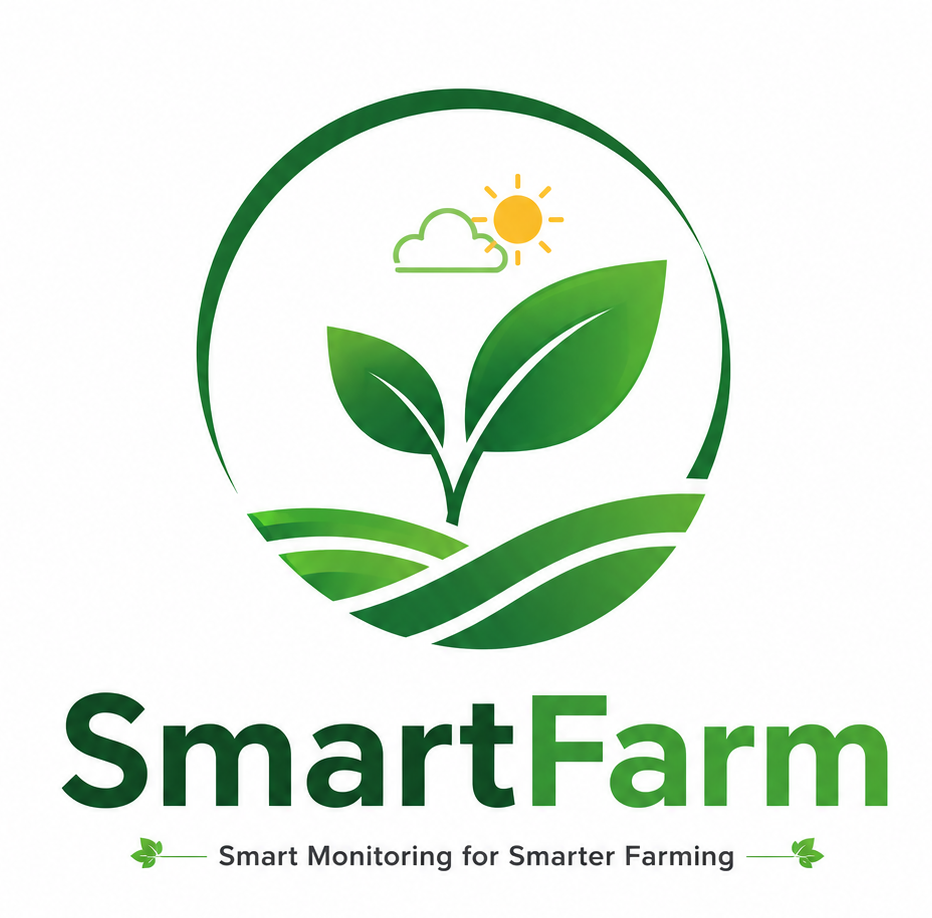
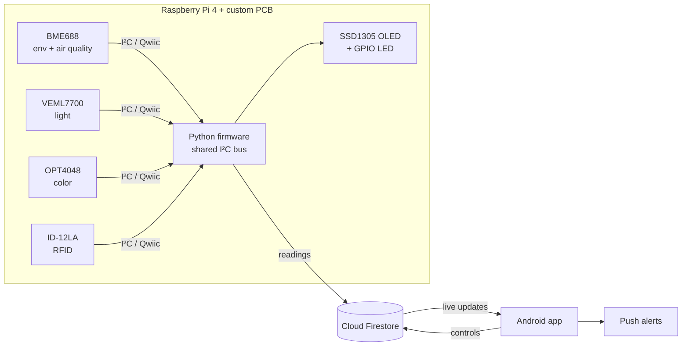

<p align="center">
  
</p>

<h1 align="center">Smart Farm</h1>

<p align="center">
  <b>Real-time farm monitoring: Raspberry Pi sensors → Cloud Firestore → Android app with live alerts</b>
</p>

<p align="center">
  
  
  
  
  
</p>

---

## Overview

Smart Farm is an end-to-end IoT system that helps growers watch their environment remotely.
A Raspberry Pi 4 with a **custom sensor PCB** measures temperature, humidity, pressure, air
quality, light, and produce color, reads RFID tags, and shows status on a small OLED. Every
reading is uploaded to **Cloud Firestore**, and an **Android app** displays the data live,
charts history, and sends notifications when conditions go out of range.

Built by a team of four as our Computer Engineering Technology capstone at Humber College.

## Features

**Hardware & firmware (Raspberry Pi 4)**
- 🌡️ **Environment:** temperature, humidity, pressure, and gas/air quality (BME688)
- 💡 **Light:** ambient lux (VEML7700)
- 🍅 **Produce color classification:** GREEN / YELLOW / BROWN / RED with a calibration mode (OPT4048)
- 🏷️ **RFID:** ID-12LA reader on an I²C carrier board
- 🖥️ **On-device display:** SSD1305 128×32 OLED status screen, plus a GPIO LED indicator
- ☁️ **Cloud upload:** timestamped readings written to Firestore
- 🧵 **Reliable I²C:** one shared bus with a single lock across all devices, so threads never collide

**Android app**
- 🔐 Email and Google sign-in (Firebase Authentication), account profile with photo
- 📊 Live dashboard of the latest sensor readings
- 📈 History and analytics graphs (MPAndroidChart)
- 🚨 Threshold alerts with push notifications and a cooldown so you aren't spammed
- 🎛️ Control panel for device actions (irrigation pump, fan, light, auto mode)
- 🌙 Light and dark themes, French translation, unit switching, landscape layouts
- 💬 In-app feedback and help pages
- ✅ Unit tests (JUnit, Robolectric) and UI tests (Espresso)

## How it works



Firestore layout used by the firmware and the app:

```
sensor_data/{deviceId}/readings/{timestamp}   ← sensor readings from the Pi
devices/…                                      ← registered devices and controls
history/…                                      ← alert history
feedback/…                                     ← in-app feedback
```

## Tech stack

| Layer | Tools |
|---|---|
| Mobile app | Java, Android SDK (min SDK 31), Material Components, MPAndroidChart, Glide |
| Cloud | Firebase Authentication, Cloud Firestore, Firebase Storage |
| Firmware | Python 3, Adafruit Blinka / CircuitPython libraries, smbus2, Pillow |
| Hardware | Raspberry Pi 4, BME688, VEML7700, OPT4048, ID-12LA RFID, SSD1305 OLED, Qwiic |
| Design | KiCad (custom PCB), laser-cut enclosure (SVG) |
| Testing | JUnit, Robolectric, Espresso |

## Repository structure

```
SmartFarm/
├── SmartFarmModule/      Android app (Java)
│   └── src/main/java/ca/iot/innovators/smart/farm/
│       ├── firestore/    data managers for sensors, devices, alerts
│       ├── ui/           dashboard, control panel, settings, help, feedback
│       ├── alert/        alert list and notifications
│       ├── history/      analytics graphs
│       └── login/ signup/ profile/
├── hardware/
│   ├── firmware/         Raspberry Pi Python scripts
│   ├── pcb/              KiCad schematic and board files
│   └── *.svg, *.docx     enclosure drawings, bill of materials, build reports
├── docs/                 project deliverables 1–5 (PDF)
├── system/               weekly course status reports
└── privacy-policy/       app privacy policy and account deletion pages
```

## Getting started

### Raspberry Pi firmware

```bash
# 1. Enable I²C:  sudo raspi-config → Interface Options → I2C
# 2. Install dependencies
pip3 install adafruit-blinka adafruit-circuitpython-bme680 \
             adafruit-circuitpython-veml7700 adafruit-circuitpython-ssd1305 \
             adafruit-circuitpython-opt4048 smbus2 pillow google-cloud-firestore
# 3. Check that the sensors are detected
i2cdetect -y 1        # expect 0x10, 0x15, 0x3C, 0x77 (and the OPT4048)
# 4. Run
cd hardware/firmware
python3 pcb_sensors_color_oled_firestore.py             # everything
python3 pcb_sensors_color_oled_firestore.py calibrate   # color calibration only
```

You'll need a Firebase service account key on the Pi for the Firestore upload.

### Android app

1. Open the project in **Android Studio**.
2. Add your own `google-services.json` from a Firebase project to `SmartFarmModule/`.
3. Build and run on a device or emulator running Android 12 (API 31) or later.

## Project documents

- 📄 [Deliverables 1–5](docs/)
- 🪧 [Project poster](hardware/SmartFarm_poster.pdf)
- 🔌 [PCB design files](hardware/pcb/)
- 🧾 [Bill of materials](hardware/Smart%20Farm%20-%20BoM.docx)

## Team

| Member | Focus |
|---|---|
| Chau Vi Cuong Nguyen | Hardware, firmware, PCB design |
| Hoang Tran | Hardware, firmware, RFID reader |
| Truong An Nguyen | Hardware, firmware, OPT4048 color sensing |
| **Tuan Anh Pham** | Hardware, firmware, sensor integration |

### My contribution (Tuan Anh Pham)
- Merged the PCB sensor script and the OPT4048 color-classification script into one program
  (`pcb_sensors_color_oled_firestore.py`) that drives every sensor, the OLED, and the Firestore upload
- Diagnosed and fixed a bug where the RFID reader status stored in Firestore didn't match the reader's real state
- Wrote my individual hardware report with build instructions for the Raspberry Pi platform

> This repository is my fork of the team's capstone project.
