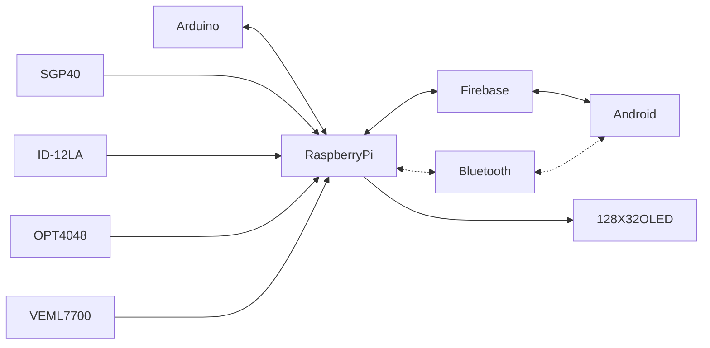

# Brief CENG Capstone Project Charter
-  [ ] Select Project area:
1. [ ] :bike: Facilities: e.g. Bicycle Rental/Parking Lot/Vision System
2. [x] :factory: Building Automation: e.g. Greenhouse/SolarPanel/Home
3. [ ] :movie_camera: Consumer: e.g. Entertainment Protocol DMX/Baby Monitoring Project
4. [ ] :mortar_board: Education: e.g. Robust Hackable Educational Project
5. [ ] :robot: Robotics: e.g. Control/Navigation/Dashboard
6. [ ] :ski: Health and Wellness: e.g. Wearable
####  Project Title: 
Smart Farm Project

####  Executive Summary/Description of the Project (75 to 100 words): 
Smart Farm is an application that provides real-time environmental monitoring and automated alert systems for farming purpose. The app displays live sensor data (temperature, humidity, light, air quality, and color detection) received from a Raspberry Pi-based hardware system. It includes manual monitoring controls and triggers instant notifications when abnormal conditions are detected, helping farmers maintain a healthy environment remotely.
####  Has this project been approved by all parties for [posting](https://appliedtechnology.humber.ca/shows/advanced-manufacturing-projects-2025/search-projects-by-program/computer-engineering-technology.html) (Y/N)?
-  [x] Yes
-  [ ] No

Optional Collaborator fields for sponsored projects

#### Sponsoring Industry and Personnel:
#### Hours contributed: 
#### Number of full-time employees, year established, private or not-for-profit:  
#### Value of equipment or access to equipment provided: 
#### FAST contribution: 

####  List of Names of Students Involved in Project (first and last names and separate members by a comma):
Nguyen Chau Vi Cuong, Tran Hoang, Pham Tuan Anh, Nguyen Truong An

####  Planned contact email for the [Expo submission form](https://appliedtechnology.humber.ca/shows/past-shows/advanced-manufacturing-projects/advanced-manufacturing-student-submission-form.html)
smartfarm-ceng322@googlegroups.com

####  For each individual student state whether they have a complete parts kit, a multimeter, what development platform they have, what sensors/effectors they have along with system Requirements (List what sensors/effectors are to do), functionalty of prototype/describe any unsoldered connections.
Student A Name Nguyen Chau has:
- [x] Complete parts kit
- [ ] Multimeter
- Development platform: Broadcom single board computer
- Sensor/effector 1:
  - IC Part number: VEML7700
  - Descriptive Name: VEML7700 Light (Ambient) Sensor Qwiic, STEMMA QT Platform Evaluation Expansion Board
  - Link to IC datasheet: [link](https://cdn-learn.adafruit.com/downloads/pdf/adafruit-veml7700.pdf)
  - Link to Sparkfun/Adafruit breakout product page: [link](https://learn.adafruit.com/adafruit-veml7700?view=all)
  - Link to Sparkfun/Adafruit hookup tutorial: [link](https://cdn-learn.adafruit.com/downloads/pdf/adafruit-veml7700.pdf)
  - DigiKey purchasing link: [link](https://www.digikey.ca/en/products/detail/adafruit-industries-llc/4162/9997696)
  - DigiKey stock status: 481
  - I2C address: 0x10
  - Mounting hole spacing:
    - Hole Spacing (Pitch): 0.5 inches / 12.7 mm (centered from hole to hole).
    - Grid Alignment: Placed on a standard 0.1-inch (2.54mm) protoboard/breadboard-friendly spacing grid
  - Additional device specific components:
    - 3.3V voltage regulator (allows 3-5VDC input)
    - Logic level shifter (for 3.3V or 5V power/logic compatibility)
    - I2C pullup resistors (no external pullups required)
    - Power LED (green, labeled "on") with a cuttable jumper on the back to disable it
    - STEMMA QT / Qwiic JST SH connectors (on the STEMMA QT version)
    - 5-pin header strip (on the original version)
  - Additional device specific connections in addition to or instead of Qwiic cable: 
    - Instead of Qwiic: 5-pin header breakout pads labeled VIN, GND, SCL, SDA, and 3Vo.
    - 3Vo Pin: This is a 3.3V output from the on-board voltage regulator, capable of supplying up to 100mA.
    - VIN: Power input that accepts 3-5VDC.
  - Current hardware operational status: Working/Tested

Student B Name Nguyen Truong An has:
- [x] Complete parts kit
- [ ] Multimeter
- Development platform: Broadcom single board computer
- Sensor/effector 2:
  - IC Part number: OPT4048
  - Descriptive Name: OPT4048DTSR Color Sensor Qwiic Platform Evaluation Expansion Board
  - Link to IC datasheet: https://cdn.sparkfun.com/assets/4/3/4/8/f/opt4048.pdf
  - Link to Sparkfun/Adafruit breakout product page: https://www.sparkfun.com/sparkfun-tristimulus-color-sensor-opt4048dtsr-qwiic.html
  - Link to Sparkfun/Adafruit hookup tutorial: https://docs.sparkfun.com/SparkFun_Tristimulus_Color_Sensor-OPT4048/introduction/
  - DigiKey purchasing link: https://www.digikey.ca/en/products/detail/sparkfun-electronics/22638/21679199
  - DigiKey stock status:26
  - I2C address:0x44
  - Mounting hole spacing:
  - Additional device specific components: N/A
  - Additional device specific connections in addition to or instead of Qwiic cable: N/A
  - Current hardware operational status: Working with some limitation

Student C Name Pham Tuan Anh has:
- [x] Complete parts kit
- [ ] Multimeter
- Development platform: Broadcom single board computer
- Sensor/effector 3: 
  - IC Part number: SSD1305 
  - Descriptive Name: SSD1305 OLED 2.23" Display Raspberry Pi Platform Evaluation Expansion Board
  - Link to IC datasheet: https://mm.digikey.com/Volume0/opasdata/d220001/medias/docus/424/4567_Web.pdf
  - Link to Sparkfun/Adafruit breakout product page: https://www.adafruit.com/product/2675?srsltid=AU7gw4WIeVfQGv7a0dzNYtgVpvrdFnxG4P6EnheKKAqH8RpJQtbsL_Wx
  - Link to Sparkfun/Adafruit hookup tutorial: https://learn.adafruit.com/2-3-monochrome-128x32-oled-display-module
  - DigiKey purchasing link: https://www.digikey.ca/en/products/detail/adafruit-industries-llc/4567/12339162?gclsrc=aw.ds&gad_source=1&gad_campaignid=17336435733&gbraid=0AAAAADrbLlg_HziuJsxJ8dyG55s0myqpj&gclid=CjwKCAjwwrPVBhA1EiwAv_YO-S5rUJ8qgrdmL4uQXztr6Y6J0bwtmBn3voFh6VK80hP8NCdgNoeh3hoCfaIQAvD_BwE
  - DigiKey stock status: 85
  - I2C address: 0x3C
  - Mounting hole spacing: Horizontal Spacing: 58.0 mm (center-to-center) Vertical Spacing: 49.0 mm (center-to-center) Hole Diameter: 2.75 mm 
  - Additional device specific components: N/A
  - Additional device specific connections in addition to or instead of Qwiic cable: N/A
  - Current hardware operational status: Working

Student D Name Tran Hoang has:
- [x] Complete parts kit
- [ ] Multimeter
- Development platform: Broadcom single board computer
- Sensor/effector 4: 
  - IC Part number: SGP40 
  - Descriptive Name:SparkFun Air Quality Sensor - SGP40 (Qwiic)
  - Link to IC datasheet: https://cdn.sparkfun.com/assets/e/6/2/6/d/Sensirion_Gas_Sensors_SGP40_Datasheet.pdf 
  - Link to Sparkfun/Adafruit breakout product page: https://www.sparkfun.com/sparkfun-air-quality-sensor-sgp40-qwiic.html
  - Link to Sparkfun/Adafruit hookup tutorial: https://learn.sparkfun.com/tutorials/air-quality-sensor---sgp40-qwiic-hookup-guide 
  - DigiKey purchasing link:https://www.digikey.com/en/products/detail/sparkfun-electronics/SEN-18345/14565027  
  - DigiKey stock status:Active 
  - I2C address: 0x59 
  - Mounting hole spacing:The board matches the standard Qwiic breakout size of 1.0" x 1.0" (25.4mm x 25.4mm) and has two mounting holes that fit a 4-40 screw
  - Additional device specific components: The board features 2x Qwiic connectors for daisy-chaining
  - Additional device specific connections in addition to or instead of Qwiic cable: Standard 0.1"-spaced plated through-hole (PTH) header pins are broken out for power and I2C communication if you don't want to use the Qwiic cable
  - Current hardware operational status: Not yet Tested
- Sensor/effector 5: 
  - IC Part number:  ID-12LA
  - Descriptive Name: SparkFun RFID Qwiic Reader
  - Link to IC datasheet: N/A
  - Link to Sparkfun/Adafruit breakout product page: https://www.sparkfun.com/sparkfun-rfid-qwiic-reader.html 
  - Link to Sparkfun/Adafruit hookup tutorial: https://learn.sparkfun.com/tutorials/sparkfun-qwiic-rfid-idxxla-hookup-guide  
  - DigiKey purchasing link:https://www.digikey.com/en/products/detail/sparkfun-electronics/15191/9995756 
  - DigiKey stock status:Active 
  - I2C address: 0x15 
  - Mounting hole spacing:The board dimensions are 1.00" x 1.24" (25.4mm x 31.5mm) . While the exact hole spacing isn't listed in the search results, it is described as "breadboard friendly" with standard 0.1-inch spaced pins
  - Additional device specific components: he board includes a red LED, a magnetic buzzer, and two Qwiic connectors
  - Additional device specific connections in addition to or instead of Qwiic cable: You may need to solder a wire to the INT (interrupt) pin if you want to use that feature to signal when a tag is read
  - Current hardware operational status: Tested

####  GitHub repository link(s):
[Smart Farm - repository](https://github.com/ChauViCuongNguyen4611/SmartFarm)

####  Google Play App download link if available:
[Smar Farm - Google Play App (closed test only)](https://play.google.com/store/apps/details?id=ca.iot.innovators.smart.farm)

#### Hours per student:
$14\*3=42$ in class hours, $14\*3=42+$ outside of class.

#### Supervising Faculty: 
Kris Medri   

####  Hours per faculty: 
$14\frac{3}{20}\*3=6.3$ in class, $14\frac{1.05+1.49}{20}\*3=5.334+$ outside of class.

####  Scope:
Creation of a Prototype that is not to be left powered unattended. Keeping safety and Z462 in mind, the highest AC voltage that is to be used is 16Vrms from a wall adapter from which +/- 15V or as high as 45 VDC can be obtained. Maximum power consumption is to be 20 Watts. In alignment with the space below the tray in the Humber North Campus Electronics Parts kit the overall project maximum dimensions are 12 13/16" x 5 ¹/₂" x 2 ³/₄" = 32.5cm x 14cm x 7cm. If your PCB doesn’t work or you need to switch sensors/effectors, it is recommended that you use the SparkFun Qwiic system: https://www.sparkfun.com/products/15945

####  Design approach:

####  Mandate: 
Self funded (unless a sponsor has contractually agreed to contribute).
